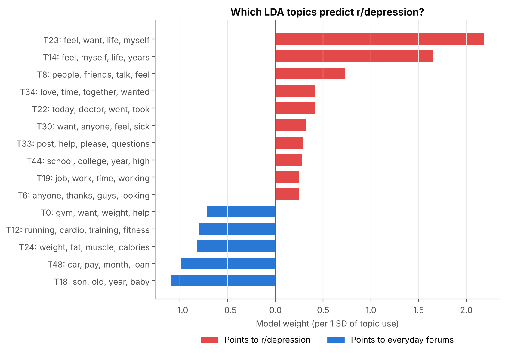
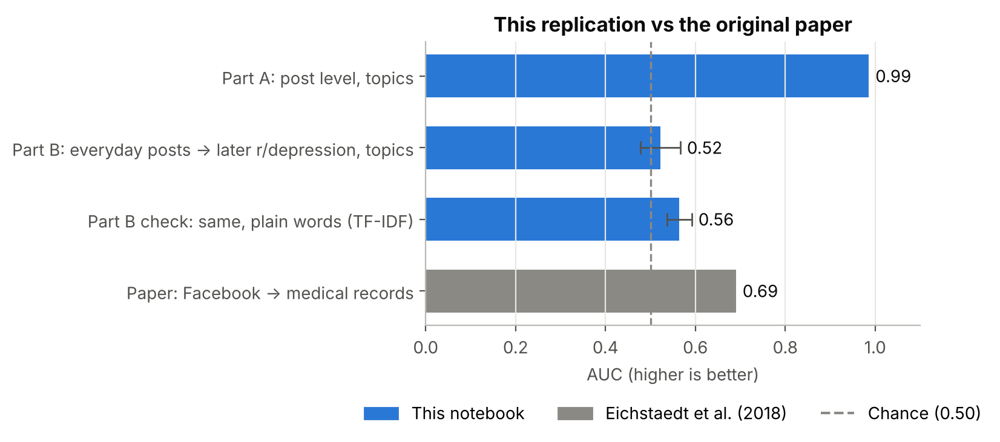

# Can everyday language reveal depression?
A small Reddit replication of **Eichstaedt et al. (2018), *Facebook language predicts depression in medical records*** (PNAS).

## What it does
- **Part A**: 50 LDA topics + logistic regression tell r/depression posts apart from everyday posts (r/fitness, r/personalfinance, r/parenting). It shows **which topics predict depression** and checks them against the paper's themes: sadness, loneliness, hostility and rumination.
- **Part B**: the test closest to the paper. It uses only a user's *everyday* posts written **before** their first r/depression post. Controls are matched on forum, number of posts and time of year.

## Results
| Test | AUC |
|---|---|
| Part A: r/depression vs everyday posts (topics) | **0.99** |
| Part B: everyday posts → later r/depression (topics) | 0.52 ± 0.04 |
| Part B check: plain words (TF-IDF) | 0.56 ± 0.03 |
| Paper: Facebook → medical records | 0.69 |

- The strongest depression topics match the paper. The top two are **self-focus / rumination and hostility** (*feel, want, life, myself, hate, nothing*). The third is **interpersonal** (*people, friends, talk*).
- Part B is close to chance. This dataset keeps one post per user in each forum, so 96% of users had only one everyday post. The paper, in contrast, used months of Facebook posts per person. Also, task-focused forums say little about mood. The signal seems to live in open-ended, personal writing.

## Run it
1. Install [Anaconda](https://www.anaconda.com/download) (or `pip install -r requirements.txt`).
2. On Windows, double-click `run_notebook.bat`. Or open `reddit_depression_lda.ipynb` in Jupyter or VS Code and click **Run All**.

The first run downloads the data (about 231 MB, Nov 2018 – Nov 2019, before COVID-19) into `data/`. A full run takes about 5–10 minutes.

## Data
Low, D. M., et al. (2020). *Reddit Mental Health Dataset.* Zenodo. https://zenodo.org/records/3941387

## Ethics
These are public, pseudonymous posts, and usernames are never shown. Posting in r/depression is a proxy, not a diagnosis. This is a research exercise, not a screening tool.

---
Sabeeh · MSc Data Science & Analytics, KFUPM · [github.com/Sabeeh11](https://github.com/Sabeeh11)
